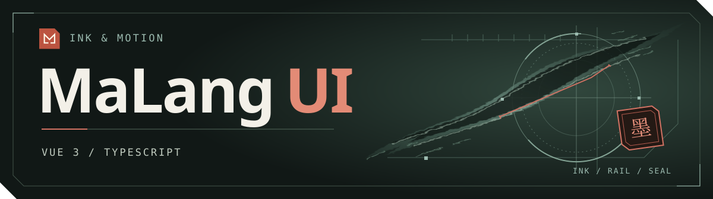

# MaLang UI



[](https://github.com/MaLaNg116/malang-ui/actions/workflows/ci.yml)

以水墨材质和机械切面构建界面的 Vue 3 + TypeScript 组件库。MaLang UI 把常用业务组件、可控制的 GSAP 动效和纯 TypeScript 工具放在同一套设计体系中。

[本地体验](#本地体验) · [快速接入](#快速接入) · [组件与动效指南](docs/component-guide.md) · [开发与贡献](docs/development.md)

- **100 个 Vue 组件**，覆盖表单、日期时间、导航、反馈、布局和数据展示。组件统一使用 `M` 前缀，例如 `MInput` 和 `<m-input>`。
- **四种纸墨材质**，浅色有宣纸朱砂、青瓷冷玉和绢素鎏金，深色使用浓墨。主题、密度和减少动效可按区域设置。
- **七个动效工厂**，包含品牌开场、墨迹切面、成功落印等六套 Canvas MG 和 DOM 错峰。支持播放、暂停、定位、重播及实例清理。
- **独立工具入口**，可在无 Vue、无 GSAP 的项目中使用防抖、节流和异步锁。

## 本地体验

使用 Node.js 24 或更高版本及 pnpm 11.25。

```sh
git clone https://github.com/MaLaNg116/malang-ui.git
cd malang-ui
pnpm install
```

| 入口 | 命令 | 本地地址 |
| --- | --- | --- |
| 官网 | `pnpm dev:website` | [127.0.0.1:5173](http://127.0.0.1:5173/) |
| Storybook | `pnpm dev` | [127.0.0.1:6006](http://127.0.0.1:6006/) |

在两个终端分别启动服务。官网提供组件检索、材质切换、MG 展台和接入指南。组件详情含页内 API 参考与 Storybook 交互示例，`MButton` 和 `MInput` 另有常用用法与可复制代码。Storybook 也可独立查看组件状态、参数和业务组合。

## 快速接入

当前安装包从仓库本地构建，尚未发布到 npm。先在本仓库打包。

```sh
pnpm build
pnpm pack
```

在你的 Vue 3 项目中安装生成的文件，将示例路径替换为实际位置。

```sh
pnpm add "/path/to/malang-ui-0.1.0.tgz" vue@^3.5.0
```

```vue
<script setup lang="ts">
import { ref } from 'vue';
import { MButton, MInput } from 'malang-ui';
import 'malang-ui/style.css';

const name = ref('');
</script>

<template>
  <main data-ui-theme="light" data-ui-palette="celadon">
    <MInput v-model="name" label="项目名称" />
    <MButton variant="secondary" @click="name = ''">清空</MButton>
  </main>
</template>
```

样式在应用入口导入一次即可。包以 ESM 提供，原生弹层面向支持 `dialog.showModal()` 和 Popover API 的现代浏览器。

## 包入口

| 入口 | 用途 |
| --- | --- |
| `malang-ui` | Vue 组件、类型、工具与 Vue 组合式 API |
| `malang-ui/utils` | 纯 TypeScript 工具，无 Vue 或 GSAP 依赖 |
| `malang-ui/motion` | Canvas MG 与 DOM 错峰工厂 |
| `malang-ui/all` | UI、工具和动效的聚合入口 |
| `malang-ui/style.css` | 组件样式与设计变量 |
| `malang-ui/tokens.css` | 单独使用设计变量 |

使用 `motion` 或 `all` 时，在消费项目中运行 `pnpm add gsap@^3.15.0`。基础组件入口无需安装 GSAP。主题容器、浮层、表单和动效生命周期见[组件与动效指南](docs/component-guide.md)。

## 开发与贡献

修改组件时，为交互或状态提供可复现的 Story，并检查键盘操作、窄屏和减少动效。提交前运行 `pnpm check`。官网改动可通过 `pnpm build:website` 和 `pnpm test:website` 检查生产产物。详细命令见[开发与贡献指南](docs/development.md)。

报告问题时，请附上组件名称、运行环境和最小复现。 [GitHub Issues](https://github.com/MaLaNg116/malang-ui/issues)

## 许可证

[MIT](LICENSE) · [第三方声明](THIRD_PARTY_NOTICES.txt)
